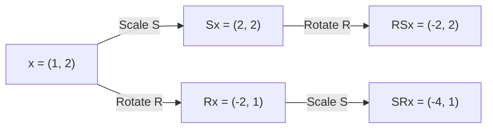

**Transformation paths (graph):**

### Exercise 9. Composing Transformations

Let

$$
S=
\begin{pmatrix}
2 & 0 \\
0 & 1 \\
\end{pmatrix},
\quad
R=
\begin{pmatrix}
0 & -1 \\
1 & 0 \\
\end{pmatrix}
$$

The matrix $S$ describes nonuniform scaling, while $R$ describes a $90^\circ$ counterclockwise rotation. For

$$
x=
\begin{pmatrix}
1 \\
2 \\
\end{pmatrix}
$$

compute $RSx$ and $SRx$. Compare the results and explain geometrically why the order of these transformations matters.

---

### Solution

#### Step 1: Compute $RSx$ (Scaling first, then Rotation)

First, compute the scaled vector $Sx$:

$$
Sx =
\begin{pmatrix}
2 & 0 \\
0 & 1 \\
\end{pmatrix}
\begin{pmatrix}
1 \\
2 \\
\end{pmatrix}
=
\begin{pmatrix}
(2)(1) + (0)(2) \\
(0)(1) + (1)(2) \\
\end{pmatrix}
=
\begin{pmatrix}
2 \\
2 \\
\end{pmatrix}
$$

Next, apply rotation $R$ to $Sx$:

$$
RSx =
\begin{pmatrix}
0 & -1 \\
1 & 0 \\
\end{pmatrix}
\begin{pmatrix}
2 \\
2 \\
\end{pmatrix}
=
\begin{pmatrix}
(0)(2) + (-1)(2) \\
(1)(2) + (0)(2) \\
\end{pmatrix}
=
\begin{pmatrix}
-2 \\
2 \\
\end{pmatrix}
$$

#### Step 2: Compute $SRx$ (Rotation first, then Scaling)

First, compute the rotated vector $Rx$:

$$
Rx =
\begin{pmatrix}
0 & -1 \\
1 & 0 \\
\end{pmatrix}
\begin{pmatrix}
1 \\
2 \\
\end{pmatrix}
=
\begin{pmatrix}
(0)(1) + (-1)(2) \\
(1)(1) + (0)(2) \\
\end{pmatrix}
=
\begin{pmatrix}
-2 \\
1 \\
\end{pmatrix}
$$

Next, apply scaling $S$ to $Rx$:

$$
SRx =
\begin{pmatrix}
2 & 0 \\
0 & 1 \\
\end{pmatrix}
\begin{pmatrix}
-2 \\
1 \\
\end{pmatrix}
=
\begin{pmatrix}
(2)(-2) + (0)(1) \\
(0)(-2) + (1)(1) \\
\end{pmatrix}
=
\begin{pmatrix}
-4 \\
1 \\
\end{pmatrix}
$$

#### Step 3: Comparison and Geometric Explanation

Comparing the two transformed vectors:

$$
RSx =
\begin{pmatrix}
-2 \\
2 \\
\end{pmatrix}
\neq
\begin{pmatrix}
-4 \\
1 \\
\end{pmatrix}
= SRx
$$

**Geometric Explanation:**
- In $RSx$, the initial vector $\begin{pmatrix} 1 \\ 2 \end{pmatrix}$ is stretched horizontally by a factor of $2$ along the $x$-axis, becoming $\begin{pmatrix} 2 \\ 2 \end{pmatrix}$. Rotating this vector $90^\circ$ counterclockwise moves its stretched $x$-component to the positive $y$-axis, resulting in $\begin{pmatrix} -2 \\ 2 \end{pmatrix}$.
- In $SRx$, the vector is rotated $90^\circ$ counterclockwise first, which swaps and transforms its components to $\begin{pmatrix} -2 \\ 1 \end{pmatrix}$. Applying the horizontal scaling afterwards doubles its new $x$-component (which originated from the original $y$-component), resulting in $\begin{pmatrix} -4 \\ 1 \end{pmatrix}$.

Because $S$ stretches only along the $x$-axis, rotating before scaling targets a different coordinate axis than scaling before rotating, making the transformation order matter.